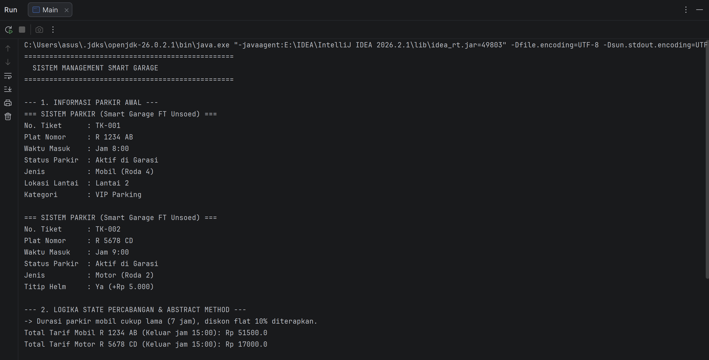
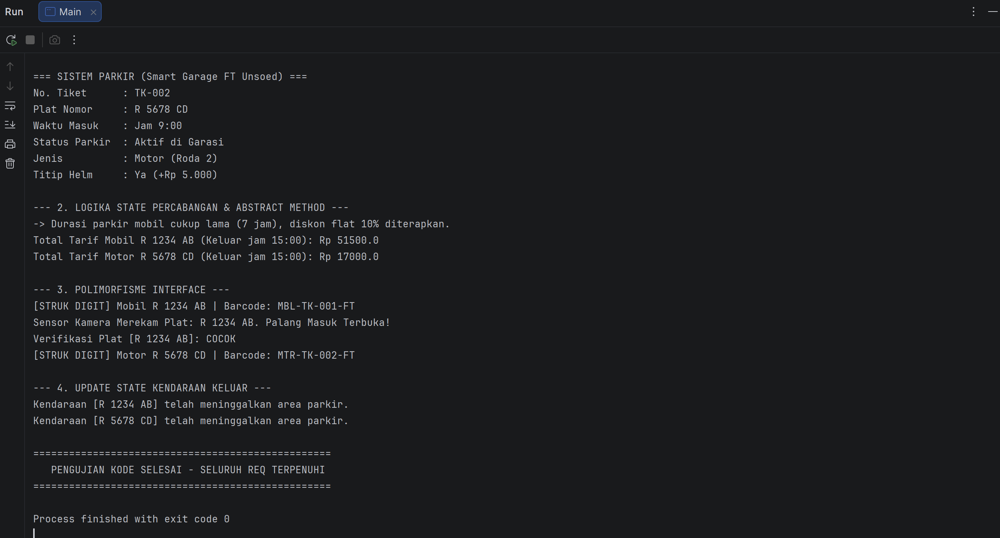

# Responsi Akhir PBO - Tema Otomotif (Smart Garage)

Disusun untuk memenuhi penugasan Responsi Praktikum Pemrograman Berorientasi Objek (PBO) Jurusan Informatika, Fakultas Teknik, Universitas Jenderal Soedirman.

## Identitas Mahasiswa
- Nama : Yumna Tiara Afif
- NIM  : H1D025129
- Shift KRS : D
- Shift Baru :G
- Digit Terakhir NIM : 9 (Tema Otomotif)
- Tema Sistem : Otomotif (Smart Garage & Parkir Bertingkat)

---

## Petunjuk Compile dan Run via Terminal

1. Buka Terminal dan masuk ke folder `src`:
   ```bash
   cd src
2. Compile seluruh file Java:
   ```bash
   javac *.java
3. Jalankan program utama Main:
   ```bash
   java Main

## Luaran Program
   

   